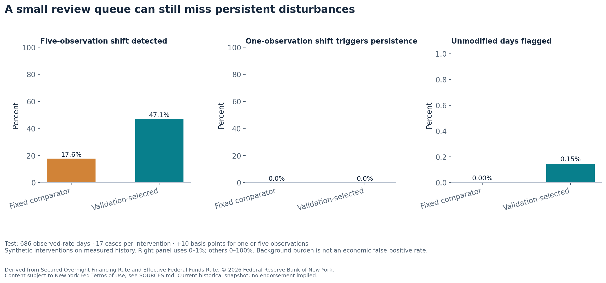
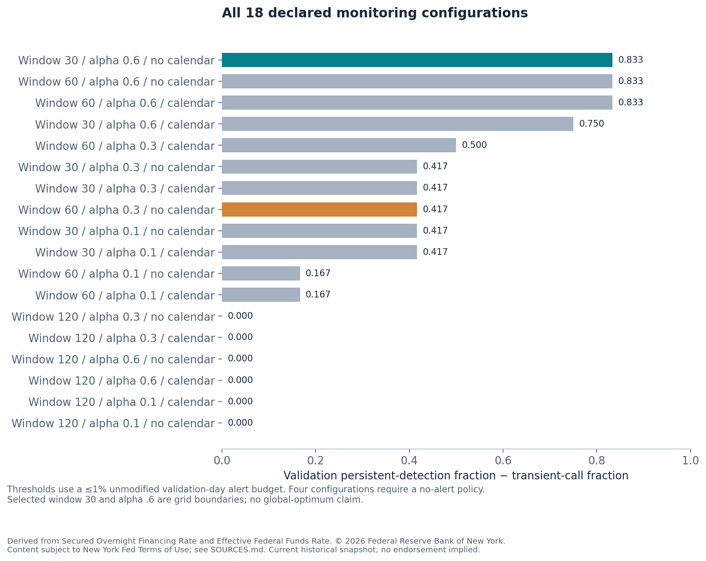
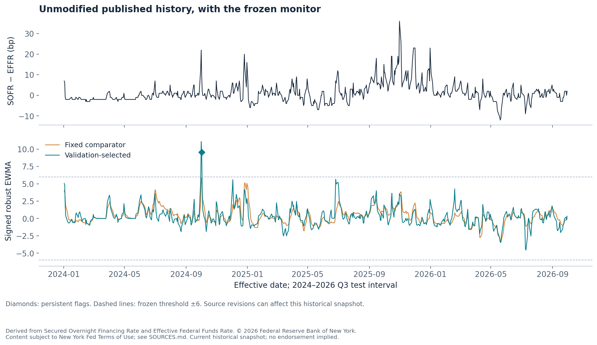

# Funding alerts: persistence versus review burden

**Finding:** the validation-selected monitor detects **8 of 17** five-observation, +10 basis-point interventions on the protected later period, compared with **3 of 17** for the fixed comparator. Both make zero new persistent calls in 17 one-observation interventions. The selected rule flags one of 686 unmodified days. It still misses nine persistent scenarios, so a small review queue alone is an inadequate success criterion.

The decision is how to screen funding-spread disturbances for review while distinguishing transient changes from sustained ones. The study uses measured public reference rates, then applies **explicitly synthetic interventions** to compare fixed monitoring policies. The next step is saved publication vintages and independently adjudicated episodes before setting an operating review budget.



## Source, SQL and information boundary

The original sources are **Secured Overnight Financing Rate** and **Effective Federal Funds Rate**, Federal Reserve Bank of New York. The two current historical API snapshots contain 2,123 and 2,135 rows, respectively. SQL joins exactly matching effective dates, retaining 2,123 observations from April 2018 through September 2026. Twelve EFFR-only dates are accounted for; no rates are interpolated. Source hashes, queries and date reconciliation are retained.

The spread is **100 × (SOFR percentage rate − EFFR percentage rate)**, in basis points. The monitor uses each current spread for triage and earlier observations for its adaptive center, scale and calendar correction. The source is a current historical snapshot, with no reconstruction of the first intraday release or proof of historical live availability. Revision indicators in this response are empty; that does not establish unrevised history.

## Declared optimization

The [protocol](PROTOCOL.md) separates initialization through 2021, selection on 2022–2023 and final evaluation on 2024–2026 Q3. Eighteen configurations combine trailing windows 30/60/120, EWMA alpha .1/.3/.6 and calendar correction off/on. All medians, scales and calendar effects use prior observations only. A one-basis-point scale floor prevents division by nearly constant histories. A persistent flag requires two successive absolute EWMA values above the cutoff.

Each candidate tests eight fixed cutoffs on unmodified validation days. It takes the smallest meeting an at-most-1% alert budget, or explicitly issues no alerts if no cutoff qualifies. This budget measures **review burden on unlabeled history**, not an economic false-positive rate.

For validation, separate +10 basis-point interventions last one or five observed-rate days. Starts are fixed every 40 observations, with a seven-observation outcome window. Every intervention is simulated separately, including monitor adaptation. A detection requires a new persistent flag beyond the unmodified monitor, preventing an existing background alert from counting as an intervention hit. Selection maximizes persistent-detection fraction minus transient persistent-call fraction, with lower background burden and candidate name as tie breakers.



The selected rule has window **30**, alpha **.6**, **no calendar correction** and cutoff **6**. The fixed comparator uses window 60, alpha .3, no calendar correction and its validation-calibrated cutoff 6. Selected window and alpha are grid boundaries; the finite search does not establish a global optimum. Calendar adjustment did not win the declared selection rule. [All trials and runtimes](results/search.csv), [all cutoff outcomes](results/threshold_search.csv) and the [committed selection](results/selection.json) are public.

## Protected later-period outcomes

| Measure | Selected rule | Fixed comparator |
|---|---:|---:|
| Unmodified observed-rate days | 686 | 686 |
| Unmodified days flagged | 1 (0.15%) | 0 |
| Five-observation interventions detected | 8 / 17 (47.1%) | 3 / 17 (17.6%) |
| One-observation interventions triggering new persistence | 0 / 17 | 0 / 17 |
| Median delay among detected persistent cases | 1.5 observations | 3 observations |

Delay medians concern different subsets of detected cases; they are not a paired claim of faster detection. All case dates, successes, misses, delays and background indicators are retained. The simulated cases share historical monitoring state, so no confidence interval treating them as independent events is claimed. Zero calls in 17 transient cases also does not prove a zero error rate.



## Independent checks and reproduction

```sh
python -m pip install -r requirements.txt
python -m unittest discover -s tests -v
python src/verify.py validation
python src/verify.py test
python src/check_reproduction.py
```

The independent verifier imports no monitor helpers. Standard-library median arithmetic reproduces every exported center, scale, calendar correction, EWMA, flag, controlled-intervention outcome and delay. Source hashes, joins, units, calendar flags, cutoff choices and model selection reconcile. Five contract tests cover future-input independence, persistence, constant-history scale, cached intervention equivalence and the explicit no-alert policy. The offline replay regenerates every candidate, frozen decision, test outcome and figure from cached source JSON.

A verifier initially expected an integer delay string while CSV represented nullable delays as `2.0`. Its parser was repaired without changing source data, monitor scores, selection or test policy. A final-calendar-row boundary was also corrected before test evaluation. These are implementation corrections, not new tuning results.

## Reuse and limits

© 2026 Federal Reserve Bank of New York. Content from the New York Fed subject to the [Terms of Use](https://www.newyorkfed.org/privacy/termsofuse). Original JSON and source identifiers remain unchanged. Spreads, monitoring scores, figures and synthetic interventions are this project's derived analyses; no endorsement is implied. See [source and attribution details](SOURCES.md).

This is independent, AI-assisted research. It makes no live trading, profitability, economic false-positive or validated crisis-detection claim. Manuscript drafts remain private and outside Git history. Public code, source snapshots, complete trials, figures and verification evidence support the scoped monitoring result.
